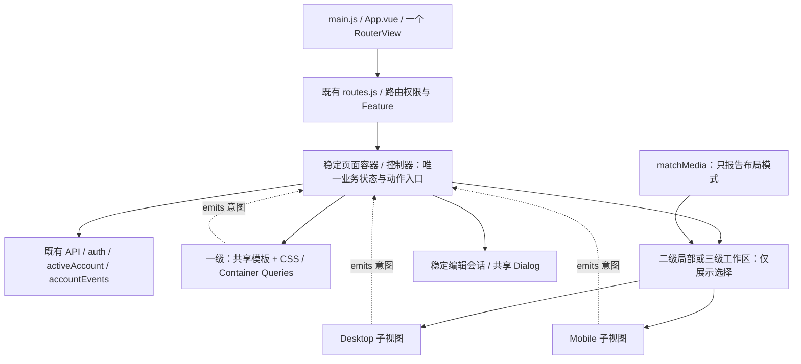

# ADR：响应式视图边界与库存操作历史试点

> 2026-10-14 后续状态：本文件的暂停扩面/等待确认等阶段范围已由 [方案 B 全站分层决策](pc-mobile-layered-architecture.md) 及用户 Goal 授权替代；历史证据保持原样。当前执行见 [迁移进度](pc-mobile-migration-progress.md)。

状态：**任务 03 局部二级方案已由用户确认（选择 A）**。观察日期：2026-10-13。下列原 P1 一级约束保留为决策历史；实施以本节修订为准。

## 任务 03 局部修订与 Implementation Plan

用户确认将操作历史的**记录列表**升级为独立 DesktopView / MobileView。试点仍为同一 `/inventory`、同一构建与账号上下文；不扩展至整个页面。原文中“任务 03 不创建双视图/尺寸逻辑”的限制在本局部被替代，其余单源业务、不变协议及安全边界继续有效。

实施基线为 `main@56a6666356ded6548424b9f49dd932f310a1df9b`，工作区干净；包含任务 02 的删除确认修复。保留其所有测试与账号 generation 校验。此次为局部 L2、rapid inline，由主会话实施；用本 ADR 和交付验证文档保存计划，不新增父仓库任务或 spec。

1. 父页继续持有摘要/报告入口、筛选、分页、所有加载/错误/撤销通知、API、确认、账号与草稿。只替换 `ul.record-list`；不搬迁业务函数。
2. 稳定 `InventoryRecordsView.vue` 宿主以受控 props/callback 连接父页；使用本区域 `matchMedia('(max-width: 640px)')` 择一挂载 DesktopView/MobileView。同步初值、监听变更、挂载后复核及卸载清理；无网络/Store/订阅。需跨视图保留的详情展开状态在稳定宿主。
3. 桌面保留原卡片与字段/侧边删除。手机 DOM 改为时间、类型/项目摘要、状态优先；原生 details/summary 承载来源、体力、完整 ID 与危险操作。可展开访问全部信息，未知类型和缺字段安全显示，长字符串换行。
4. 仅迁移列表专属 CSS 到两个视图共用的 scoped stylesheet；摘要、工具栏及全局样式不动。切换用 record_id/action 语义锚点恢复焦点和滚动；确认框仍由共享父级控制，不因 resize 关闭。
5. 先复跑任务 02 的四文件 72 项基线，再补初始/跨断点/清理/展开/焦点及双端动作测试。复用合成浏览器脚本，扩展 430/1024 和 640 临界；运行构建与精确 diff 检查，记录真实覆盖。浏览器获本任务明确授权，仅使用合成数据与现有 5173 服务；真实手机键盘/触控仍待人工验收。Git commit 单独等待用户授权。

允许文件：父页、历史双视图/稳定宿主及其局部 props/样式、历史定向行为测试、既有库存浏览器脚本、本 ADR 与本任务验证记录；不改 standards、路由、API、后端、依赖、其他模块或任务 02 历史记录。

实施结果与真实覆盖见 [任务 03 验证记录](inventory-records-dual-view-20261013.md)。

## 任务 04 复盘补记（2026-10-13）

结论为 **Adjust：保留试点，暂停扩面**。证据分层、缺陷/风险、迁移契约填写项、模块级候选及放行/回退条件见 [04 试点复盘与 Phase 2 建议](responsive-pilot-review-phase2-20261013.md)。本补记不授权修代码、创建后续任务或全面迁移，也不晋升为新的项目标准；响应式权威规范保持不变。

当前源码及历史合成验证支持复用的边界：父层持唯一业务状态/请求/权限/草稿，稳定展示宿主持布局与跨切换展开/焦点锚点，Desktop/Mobile 只择一挂载并消费同一 props/动作入口；普通尺寸变化不重建业务控制器。历史 Chromium 使用合成身份/API/SSE，不能替代真实手机或后端权限验收。

尚未验证或完成的事项不作为模式推广：共用 scoped CSS 尚未清晰区分双端公共外观与专属布局；已发出删除/恢复的迟到完成缺少完整上下文保护；没有同条件包体/维护工时对照。两项最小修正建议分别留待确认，现有有效测试保留。下一模块仍按共享响应式、局部差异、完整工作区逐级选取，不按 Vue 文件数量拆分；所有候选开始前重查现状与并行归属。

## 任务 01 原始记录（历史）

本次交付只有此文档，风险 **L0（文档，无运行时行为变化）**。任务 02/03 必须在设计确认后另行实施；本文不代表全面迁移授权，也不提升为项目标准。

## 1. 决策与范围

采用「同一 Vue 3 + Vite 项目、按需要独立桌面/移动视图、业务逻辑单源」。独立的是呈现边界，不是站点、账号、业务模型或路由。以下分级落实现有规范，不另建规范体系：

| 适配级别 | 适用条件 | 实现边界 | 本轮判定 |
| --- | --- | --- | --- |
| 一级：共享模板 | 内容、动作与阅读顺序相同，只需换行、密度或排列变化 | 同一模板 + Flex/Grid/CSS；适合的复用区域可用 Container Queries | **库存操作历史 P1**；招募时间线现状也优先保留 |
| 二级：局部独立视图 | 某一区域需要不同 DOM/信息顺序，例如密集桌面表格与移动卡片/筛选抽屉 | 稳定容器内选择 Desktop/Mobile 子组件；共享筛选、数据和动作 | 后续仅对有明确结构需求的区域使用，不扩展至整页 |
| 三级：完整工作区视图 | 多区域协作、任务编排和语义显著不同，一级/二级不足以表达 | 稳定页面控制器 + DesktopView/MobileView | 首批不采用；密探复杂度高也不能仅凭文件行数直接归入三级 |

**P1 明确选择一级**：当前操作历史是同一 `ul/li`，640px 下重排工具栏与删除按钮，没有证据证明需要两份 DOM。先抽出受控展示组件，是建立后续独立视图接缝的最小试点。任务 03 不创建内容相同的 Desktop/Mobile 副本、不引入尺寸 composable、不把桌面列表改成新表格。确需二级时，须另开局部设计任务说明结构差异与阅读顺序，再复用本 ADR 的契约。

单仓、单路由、单构建指 **YuanHub 主应用**：保留 `src/main.js → App.vue → RouterView`、`src/router/routes.js` 和既有 `npm run build`。不新增移动入口、移动路由表、独立移动 Vite 配置或 `/mobile` 站点；不变更现有辅助站点 `promo-site/`。

权威约束与直接参考：

| 文档 | 本 ADR 依赖的内容 |
| --- | --- |
| [设计规范](../standards/design-system.md) §5–6 | 工作区 Tabs、token、浮层/焦点与品牌；不得恢复旧 fixed 底栏 |
| [响应式规范](../standards/responsive-development.md) §2、3、5、7、10 | 移动优先、业务单源、内容断点、风险视口、CSS 优先与渐进改造 |
| [页面开发流程](../standards/page-development.md) §2–3、5 | 页面目录及唯一注册入口；验收范围以响应式规范风险分级为准 |
| [库存协议](../exchange-specs/inventory-v2.md)、[奖励恢复说明](../inventory-reward-recovery.md) | 历史、快照、删除恢复语义；本轮不修改契约 |
| [活动日历](../activity-calendar.md)、[招募档案](../recruitment-archive.md) | 后续候选的业务上下文；不在试点顺便改造 |

UI 调研实际读取了本机 `ui-ux-pro-max/SKILL.md`；Vue 定向检索命中生命周期/监听清理建议。应用到本设计的是清理副作用、受控状态、焦点和触控可达性；不生成新设计系统、不引入新依赖。该本机工具不是独立 clone 本仓库的运行依赖。

## 2. 观察基线与并行变更

### 2.1 Git 基线

| 仓库 | 当前分支 / HEAD | 当前工作区证据 |
| --- | --- | --- |
| YuanHub-All 父仓库 | `master` / `cd1d4a29af258ca3ccd414db34f8bf5159ae3c59` | 已有 Trellis、验证/发布脚本、文档等大量修改和未跟踪文件；本任务不改父仓库 |
| YuanHub 独立仓库 | `main` / `d7036babd77629d22f3a3ed421626ee9615984fc` | 已修改 `src/pages/recruitment/PoolEditor.vue`、`behavior/recruitmentOrder.spec.js`、`behavior/recruitmentPage.spec.js`、`behavior/recruitmentPoolEditor.spec.js`，共 4 个文件；必须保留 |

源码观察包含现有未提交招募改动，不能假定 HEAD 中的招募实现等同于当前文件。行号只用于本日期定位，实施时按符号重新定位。

收尾复核发现并行变化：前端 `AGENTS.md` 新增浏览器自动化默认禁用规则，`PoolEditor.vue` 继续变化，`behavior/recruitmentPoolEditorClose.spec.js` 也出现修改，并新增未跟踪 `src/pages/recruitment/createRecruitmentId.js`；父仓库 `AGENTS.md` 同步加入相同规则。上述文件均非本任务写入；3 个初始招募测试文件在首次收尾复核时 SHA256 与初次核对一致。并行变更仍在继续，清单仅为观察快照。后续 UI 验收默认由用户手动进行，Agent 只有在当前任务明确获准浏览器自动化后才能运行对应检查。

`git worktree list --porcelain` 实际登记的其它 worktree（以下路径相对本机 `/Users/snake/.ao/data/worktrees/yuanhub-all/`，仅作调查记录）：

| worktree | 分支 / HEAD | 状态与限制 |
| --- | --- | --- |
| `orchestrator/yuanhub-all-orchestrator` | `ao/yuanhub-all-9` / `a7e5337…` | 父仓库有既存修改；其中 YuanHub 为 `ao/yuanhub-all-9` / `f7d9e9f…`，未见 tracked 修改 |
| `yuanhub-all-2` | `ao/yuanhub-all-2` / `a7e5337…` | 父仓库有既存修改；没有独立 YuanHub `.git`，不计作可用前端 worktree |
| `yuanhub-all-4` | `ao/yuanhub-all-4` / `a7e5337…` | 父仓库有既存修改；其中 YuanHub 为 `ao/yuanhub-all-4` / `05cc0ae…`，未见 tracked 修改 |

这些副本 HEAD 落后/不同，不能直接拿来覆盖当前文件；“未见 tracked 修改”也不证明没有后台执行者或未提交的未来工作。本任务未合并、切分支或触碰它们。

### 2.2 任务冲突清单

下表来自父仓库 `.trellis/tasks/*/task.json`，是记录状态，不是对他人实时工作状态的确认。为使 YuanHub 能独立阅读，此处保留名称与状态，不将父目录文件作为开发依赖。

| 模块 | 尚未归档的相关记录（抽样） | 实施前门槛 |
| --- | --- | --- |
| 库存试点 | `09-22-inventory-type-switch-layout`、`09-23-inventory-reward-workspace-dialog`、`10-03-inventory-training-quick-entry` 为 `in_progress`；`10-05-inventory-resource-remediation` 为 `review` | **试点也有重叠风险**：核对 `inventory/index.vue`、`RewardEntryWorkspace.vue`、库存测试的最终归属；后者记录的外部 worktree 已不存在，不得当作已验收 |
| 密探 | `09-27-operator-catalog-mobile-filter`、`09-29-operator-scan-review`、`10-05-operator-quick-remediation`、`10-13-operator-awakening-continuity` 为 `in_progress` | 等觉醒、复核、快捷录入交接；quick-remediation 记录的 worktree 已不存在 |
| 日历 | `10-03-activity-calendar-multi-view`、`10-05-activity-calendar-subscriptions`、`10-09-activity-calendar-unsaved`、`10-10-calendar-private-date-range`、`10-12-calendar-recruitment-integration` 为 `in_progress` | 先确认多视图、草稿保护、私人事项及招募集成已稳定；不重拆已有视图 |
| 招募 | `10-08-recruitment-daily-record`、`10-12-recruitment-avatar-drag`、`10-13-recruitment-editor-polish` 为 `in_progress`，当前有上述 4 个 dirty 文件 | avatar-drag 记录的 `.worktrees/recruitment-avatar-drag-20261012` 已不存在；当前编辑器改造完成交接前冻结迁移 |
| 反馈与导航 | `09-28-feedback-workflow-fixes`、`10-05-feedback-notifications-changelog-remediation`、`10-13-feedback-types-calendar`、`10-06-yuanhub-navigation-ia-phase1` 为 `in_progress` | 反馈通知任务记录的外部 worktree 已不存在；导航维持现状，不并行改未读与权限入口 |

后续开始任务 02、03 时重新核对两个仓库的 branch、HEAD、status、登记 worktree 及目标文件 diff。只要目标文件出现未交接改动，就暂停该文件实施，请维护者确定基线；不 reset/stash/clean、不因旧任务“看起来过期”自行归档。

## 3. 现状清单：View / State / API / Side effect

以下为**静态源码证据**，不是实机 UX 验收或 Bug 判定。

| 抽样区域与源码入口 | View 边界 | State 边界 | API 边界 | Side effect 边界 |
| --- | --- | --- | --- | --- |
| [库存操作历史](../../src/pages/inventory/index.vue)，约 1613–1776 行 | 同一历史面板、筛选按钮、`ul.record-list`、删除及撤销提示；面板用 `v-show` | 父页面持有 `recordsList`、`recordsNextCursor`、`recordsEntityType`、loading/error/busy/notices；库存盘点草稿也在父页面 | 父页面 `loadRecords` / `onDeleteRecord` / `onRestoreRecord` 调 [inventory API](../../src/api/inventory.js)；页大小 50、cursor；删除恢复后刷新历史/库存并清理统计缓存 | 父页面 mounted 初始化、账号/auth/game watch、账号事件订阅及 180ms 延迟刷新；卸载使序号失效并清订阅/计时器 |
| [密探名册](../../src/pages/operator/index.vue)，重点 catalog 面板约 453 行起 | 图鉴筛选、卡片、详情/编辑、养成总览/追踪；current/tracking 有 `visitedTabs` 懒挂载再 `v-show` | 父页面持有搜索/属性/职业、收藏、当前账号、`quickDrafts`、`cardCombatDrafts`、`cardGrowthDrafts`、`editForm`、星石草稿和冲突状态；子工作区另有自己的局部模型 | 父页面调用 operator/inventory/accounts 等现有 API；规划云状态已有 `useOperatorPlannerCloud` | 账号事件、目录/云状态加载、浮层定位、tooltip scroll/resize、卡片提交计时器；卸载清理；详情/复核有未保存保护 |
| [活动日历](../../src/pages/calendar/index.vue) | 父页面选择 Agenda/Timeline/Month；筛选 Sheet、订阅控件、私人编辑器已独立 | query 持有 scope/filter/view/date；本地偏好只作为 fallback；`useCalendarSubscriptions` 持账号/订阅、dirty 登记；`useCalendarPrivateItems` 持私人事项草稿；**CalendarSubscriptionControls 自己持 checklist 草稿** | 父页面加载公共活动；两个 composable 加载订阅/私人事项并处理写操作；订阅控件通过注入 context 调命令，不各自初始化数据加载 | 午夜/分钟/边界计时器、visibility/pageshow、路由变更/离开保护、账号切换保护；Month 内有宽度监听；父级和 composable 负责清理 |
| [招募档案](../../src/pages/recruitment/index.vue) → [RecruitmentWorkspace](../../src/pages/recruitment/RecruitmentWorkspace.vue) | 路由壳判断开放/身份；工作区组合 Timeline、PoolEditor、Exchange、教程/练习 | `useRecruitment` 持账号/档案/分页/revision；Workspace 持选池、开关及回执；**PoolEditor 持 rows、originals、orderIds/orderRevision、remaining、activeRow 等编辑草稿**；Exchange 也持导入预览 | [useRecruitment](../../src/pages/recruitment/useRecruitment.js) 包装 API、CAS/requestId、刷新读回及账号上下文；备份组件另有自身导入导出职责 | account watch、SSE 消息回调、visibilitychange；编辑器 visualViewport/window 监听及拖拽；卸载清理；练习隔离真实写入 |
| [导航](../../src/components/IslandSidebar.vue) + [MobileHeader](../../src/components/MobileHeader.vue) | Sidebar、移动 Header、条件 Teleport Drawer；均消费同一权限/Feature/未读源 | `menuOpen`、desktop details、header hidden 属于展示状态；身份/权限来自 auth/beta 等现有模块 | Sidebar 订阅反馈未读；通知/全局账号事件由 App 统一管理，不能让新视图再轮询 | 点击外部、路由变化关闭、body class、modal focus；Header matchMedia/scroll；App 负责全局流及清理 |

已有资产盘点（复用，暂不统一目录或 store 风格）：

| 资产 | 后续用途与限制 |
| --- | --- |
| `src/components/inventory/{RewardEntryWorkspace,InventoryItemName,ResourceBalanceReport,AcquiredPeriodReport}.vue` | 奖励工作台/报告已独立；P1 只把历史里的报告入口转发给现有工作台，不复制导入或奖励草稿 |
| `src/components/{DataAccountContextBar,AccountSwitcher,ArchiveExchangePanel,AppDialog}.vue` | 保留账号上下文、确认框和归档机制；不在双视图各实例化一套 |
| `src/composables/useModalFocus.js`、`src/utils/{useUnsavedChanges,persistedTab,workspaceTabs}.js` | 复用焦点、离开保护、Tab 偏好与手动激活；与尺寸选择独立 |
| `src/store/{auth,activeAccount,accountList,accountEvents}.js`、`src/stores/onboarding.js`；`src/styles/{main,tools-workspace,page-header}.css` | 当前 reactive store 与 Pinia 并存；不借迁移统一；保留 token、导航、工作区样式边界 |
| `behavior/`、`test/`、`test-support/` | Vitest/Vue Test Utils 验证真实 SFC 行为；node:test 覆盖纯逻辑/静态契约；浏览器脚本覆盖几何；实际是根 `test-support/`，不是假定存在的 `behavior/test-support/` |

### 3.1 JS 视口与 CSS 断点

| 范围 | 已确认 JS 用法 | 已确认 CSS / 含义 | 风险判断 |
| --- | --- | --- | --- |
| 库存 | `agentControlsCollapsed` 初始 `matchMedia(max-width:640px)`；菜单定位读 `innerWidth > 640`；盘点滚动偏移/reduced-motion 用 matchMedia | 历史主要在 ≤640px 重排，≥1081px 调整摘要动作；全页另有 360/760/900/1080/1200 等布局规则 | 首次折叠是可操作的初始偏好，不必随 resize 强制复位；**不能拿它直接当持续更新的视图选择器**。历史当前没有两套尺寸组件 |
| 密探 | `compactStatsQuery(max-width:640px)` 实时 change，并清理；浮层定位读窗口宽度，监听 window/visualViewport resize，tooltip resize/scroll 清理 | 420/640、641–900、768/901、1080/1081 等局部规则 | 多断点本身不是 Bug；移动统计与菜单定位有不同目的。全页换组件会重置多种草稿、懒挂载与 DOM 引用 |
| 日历 | 父页 `innerWidth >=1024` **只决定初始 fallback**，用户选的 view 不跟 resize 改；Month 的 `matchMedia(min-width:1024px)` 实时改变周条 3/4 层并清理；FilterSheet 打开时监听 ≥1024 并关闭/清理 | CSS 有 389/768/1024/1440、hover/reduced-motion；筛选 Sheet 与宽屏布局使用 1024 | 不得将月份/列表选择改为“窗口缩放自动重置”；Month 条和展开详情存在多种呈现，须按实际可交互卡片核查，不能按相同 event 出现次数断言重复请求 |
| 招募 | PoolEditor 监听 visualViewport/window resize/scroll 以修正键盘/输入可见区域，卸载移除；拖拽检测 reduced-motion | Timeline 768/1200；当前 dirty PoolEditor 431/700、≤520、pointer:coarse；EntryEditor 430 | 键盘定位监听不是业务视图切换；直接卸载 PoolEditor 会丢草稿/顺序/回执上下文，必须保持稳定宿主 |
| 导航 | MobileHeader 使用 `matchMedia(max-width:1080px)` 初始化、change 同步，按需绑定 scroll，卸载清理；Sidebar 没有根据尺寸重建数据控制器 | `main.css` 在 ≤1080 隐藏 `.island`、显示 `.mobile-shell`；Sidebar ≥1081 且高≤480 内部滚动；body 导航锁仅在 ≤1080 生效 | 同挂载桌面/移动入口由 CSS 选择可见性，不等于重复订阅；Drawer 的 open 状态跨尺寸可能保留，需后续专项验收，不在本轮顺手修改 |

本次抽样没有发现现成通用 `useMediaQuery`/`useViewport` composable（现有 composables 与 utils 已定向检索）。后续若确需 JS 选 DOM，再新增最小 helper；不引入 VueUse 或全局“设备 store”。

### 3.2 潜在重复渲染与状态丢失

| 触发条件 | 静态判断 | 处理方向 |
| --- | --- | --- |
| 给两套业务组件用 CSS 或 `v-show` 隐藏 | 两套 setup/mounted/watch 仍会运行，可能双重读取/订阅；目前库存历史自身没有这种双实例 | 带副作用的控制器永远一个；二/三级视图 `v-if/v-else` 仅挂载一个 |
| 将 `InventoryPage` / `RecruitmentWorkspace` / 日历控制器放进尺寸条件 | 控制器重建会重新读取、清空页内状态 | 尺寸选择必须在稳定控制器下面，不能给控制器加 viewport key |
| 把页面级 tab 的 `v-show` 一律改成 `v-if` | 会改变持久/懒挂载及页内状态语义 | P1 保留 `inventory-panel-records` 的 tabpanel 和 v-show；密探 `visitedTabs` 不动 |
| 切换/卸载订阅编辑卡或招募编辑器 | 当前本地业务草稿会消失；日历父级只登记 dirty 不等于持有草稿内容 | 未来先将需要存活的草稿提升到稳定编辑会话/控制器，或让编辑器本身稳定挂载；禁止以双 KeepAlive 缓存替代单源 |
| resize 期间焦点/滚动节点换掉 | 同一 record_id 的数据存在不代表焦点与滚动还在 | 一级保持节点；二/三级切换前记语义锚点，切后只恢复仍有效的目标，不重置筛选/分页 |

## 4. 目标架构与所有权



Desktop/Mobile 是择一挂载的替代关系；上图两条边不代表同时实例化。P1 只走 Shared 路径。

| 职责 | 唯一所有者 | 视图允许做什么 |
| --- | --- | --- |
| API、权限、Feature、登录/账号上下文 | 稳定页面控制器及其调用的既有 store/API；路由守卫仍在原处 | 只消费最终可用/禁用状态；不导入 auth/API 再判断，不初始化另一份账号源 |
| 筛选、分页、选中对象、编辑草稿、loading/error/冲突 | 控制器或由它**调用一次**的业务 composable；稳定编辑会话可放控制器外的共享编辑器 | 受控 props + emits；不得拷贝成独立业务 ref、watch props 后重新加载，或由布局模式决定 query |
| 删除/恢复、保存/导入、离开确认、路由跳转 | 控制器统一命令入口，捕获并校验发起时的上下文 | emit 操作意图；按钮禁用不能替代控制器校验；不自行确认后调用 API |
| SSE/轮询、重试时机、缓存失效、计时器 | 既有控制器/共享 store，沿用原生命周期 | 无业务订阅；尺寸、焦点、滚动等展示监听可以存在，但必须清理 |
| 纯展示状态与格式化 | 视图可持元素 ref、临时 hover、测量；需跨切换保留的展开/输入状态由宿主持有 | 可调用已有纯 formatter，不修改传入 records/draft；无 API composable 的重复实例 |

“受控 composable”是从宿主注入同一只读状态与命令接口，或纯展示计算；不是两视图各调用 `useRecruitment()` / `useCalendarSubscriptions()`。不新建覆盖全站的万能控制器/事件总线。

尺寸变化必须保持：未保存输入、筛选、cursor 与已加载记录、选中项、busy/loading/error、删除撤销通知、正在进行的确认和请求。尺寸变化不能触发保存、丢弃、API、订阅、路由跳转或偏好写入。账号/身份变化仍按原安全规则清理数据，不能为“保留状态”将 A 的草稿带入 B。

## 5. 响应策略

### 5.1 CSS 与 JS 分工

纯宽度、排列、换行、显隐非交互装饰、容器高度交给 CSS。Container Queries 只在确有容器复用需求时添加，本轮不把现有 viewport media 全部换成容器查询。

仅在已评审的不同 DOM 结构需要择一挂载时使用 `matchMedia`。后续可新增 `src/composables/useMediaQuery.js`（**任务 03 不创建**），契约为 `useMediaQuery(query) → Readonly<Ref<boolean>>`：

| 生命周期 | 必须满足的行为 |
| --- | --- |
| setup / 第一次渲染 | 对当前 query 同步读取 `matches`，不先硬编码 desktop 再 mounted 翻转；当前是客户端 SPA，不引入 SSR 体系 |
| mounted / resize | 绑定 `MediaQueryList.change` 后再次同步，避免 setup 到挂载之间改变尺寸；窗口跨阈值即时更新，无需刷新 |
| unmount / scope dispose | 移除同一 callback；不残留 window resize、observer、timer；参数按每个实例稳定 query 使用，不先支持动态 query |
| 非浏览器测试环境 | 缺少 matchMedia 的默认值必须显式、可测；实际选择测试使用可派发 change 的 mock，不能所有宽度恒返回 false |
| 副作用限制 | 只提供匹配值；不访问 router/store/API，不产生账号/权限/持久化语义 |

无需 UA、品牌或设备型号；触控/hover 能力独立使用 CSS media，不将窄屏等同触屏。不在 JS 中直接读取 CSS 自定义属性当作 media query 阈值，也不引入复杂断点代码生成器。

### 5.2 断点兼容与切换约束

| 边界 | 策略 |
| --- | --- |
| 网站导航 | 保留当前 ≤1080px 移动 Header/Drawer、≥1081px Sidebar 与矮桌面内部滚动；不改 token、main margin、body 锁及全站 chrome |
| P1 历史内容 | 继续当前 ≤640px 工具栏/列表重排及 ≥1081px 摘要动作规则，保持中间 641–1080px 可用；不把内容断点强绑导航断点 |
| 日历等候选 | 保留已有 1024px 的月历密度/筛选容器边界；显式 agenda/timeline/month 为用户业务偏好，不参与自动尺寸选择 |
| 新增二/三级区域 | 说明具体放不下的内容、容器与输入方式，单独记录 query 和 CSS 临界值；组件拆分不默认共用一个全站 mobile boolean |
| 跨阈值 | 稳定控制器、账号、编辑器/确认框宿主不换 key；只替换展示，若焦点目标在被卸载区域，用 record_id/field 等语义锚点恢复。视图挂载不加载数据 |

优先用互补的 `v-if/v-else` 和同一 query，避免 JS/CSS 在边界出现空白或两个可交互副本。范围语义、缩放产生的小数像素与 CSS 实际表现由浏览器临界测试确认；不以相近整数“看起来连续”作为证明。

## 6. P1 文件与接口：只抽取库存历史展示

### 6.1 精确边界

| 文件 | 任务 03 的允许改动 | 明确保留 |
| --- | --- | --- |
| `src/pages/inventory/index.vue` | 导入/连接 `InventoryRecordsPanel`；替换 **tabpanel 内部**约 1618–1776 行展示；迁移历史专属样式 | tabpanel 根节点 id/role/aria/tabindex/v-show；所有业务 refs、computed、请求函数、watch、mounted/unmount、权限和账号入口；库存清单/统计报告 |
| `src/components/inventory/InventoryRecordsPanel.vue`（新增） | 唯一历史展示树：摘要/报告入口、筛选/刷新、撤销与错误、空/加载/失败、记录列表、更多；只声明 props/emits | 不 import API/store/router/dialog，不 onMounted 请求；不接管库存/奖励草稿；不持分页或 records 副本 |
| `behavior/inventoryRecordsUx.spec.js` | 复用任务 02 的历史基线；测试真实 Panel，不能 stub 掉被抽取边界 | 有效业务断言和当前测试中的其它库存检查，不因拆组件删测试 |
| `test/responsiveViewport.test.js` | 已核对：当前覆盖库存分区编辑提示、agent 菜单命中区及页面动态高度，没有历史列表专属断言；任务 03 默认不改、不跑 | 保留现有断言，不为新组件复制一套同义正则；若实际改动触及这些原有约束再定向验证 |
| 本 ADR | 回填实施基线/验证/偏差，必须属于同一试点范围 | 不改三个权威 standards；不得自动 spec promotion |

父组件 scoped CSS 不会自动覆盖子组件内部。只移动 `.records-overview*`、`.records-head`、`.records-filter*`、`.record-list`、`.record*`、`.rtag*` 等经引用核对后的**历史专属**规则及其 media 覆盖；共享 `.btn`、`.act-btn`、`.state`、`.inventory-inline-state`、`.link`、`.load-more` 的实际使用需逐个核对。沿用已有全局类；若当前只在父 scoped 定义而子内部必需，则复制必要规则到 Panel，单纯保留同名 class 不会保住父 scoped 级联。不能依赖父 scoped 穿透，也不能批量移动报告/清单样式。触达文件超出上表时先记录原因并重新评估范围。

展示沿用当前顺序：说明/已加载数量/报告入口 → 类型筛选与刷新 → 撤销与错误 → 状态/列表/更多。移动端保留全宽删除按钮和可换行元信息；桌面保持当前列表与侧面删除。记录类型、库存效果、时间、摘要、record_id、来源及体力信息两端均可访问，不新增排序、批量删除、无限滚动、详情抽屉或缓存策略。

### 6.2 状态与接口

以下 props 使用现有命名，避免另造领域 DTO。原始 record 只读；格式化函数仍引用父级现有实现，确保缺名 fallback、负数与时间显示一致。

| props | 类型 / 来源 | 语义 |
| --- | --- | --- |
| `recordsList`, `recordsNextCursor`, `recordsEntityType` | Array / nullable String / `all\|item\|agent`；父级同名 refs | 已加载数据、是否能继续、当前筛选；禁止子组件改变 |
| `recordsLoading`, `recordsError`, `recordsRetryReset` | Boolean / String / Boolean；父级同名 refs | 首屏/增量状态，失败后恢复原 reset 方式 |
| `recordsActionError`, `recordsBusyId`, `deletedRecordNotices` | String / String / Array；父级同名 refs | 删除/撤销状态和已删除通知，父级保持 accountId 关联 |
| `accountId`, `rewardEntryDisabled`, `rewardImportBusy`, `reportOpen` | String / Boolean / Boolean / Boolean；`reportOpen = rewardEntryWorkspace?.mode === 'report'` | 保留缺账号提示、报告入口禁用与 aria-expanded；不在视图重新查询账号 |
| `fmtTime`, `entrySummary`, `stockEffectLabel`, `staminaCostOf` | 现有纯函数作为 Function props | 显示规则单源，不复制命名、数值、业务时区规则 |

| emits | payload | 父级唯一处理入口 |
| --- | --- | --- |
| `set-entity-type` | `all\|item\|agent` | `setRecordsEntityType`（保留白名单及相同值短路） |
| `reload` | Boolean reset | `loadRecords`；刷新/首屏重试传 true，更多传 false，增量失败重试传 `recordsRetryReset` |
| `delete-record` / `restore-record` | 当前只读 record / notice | `onDeleteRecord` / `onRestoreRecord`；沿用确认、busy、账号检查与后续刷新 |
| `open-report` | 发起按钮 HTMLElement | `trigger => openRewardEntry('report', trigger)`；保留焦点恢复与现有 aria-controls，不在视图调用导入 |

接口连接示意（省略表中其余 props；不是当次生产代码变更）：

```vue
<!-- inventory/index.vue：tabpanel 本身继续稳定存在 -->
<InventoryRecordsPanel
  :records-list="recordsList"
  :records-entity-type="recordsEntityType"
  :records-loading="recordsLoading"
  :fmt-time="fmtTime"
  :entry-summary="entrySummary"
  @set-entity-type="setRecordsEntityType"
  @reload="loadRecords"
  @delete-record="onDeleteRecord"
  @restore-record="onRestoreRecord"
  @open-report="trigger => openRewardEntry('report', trigger)"
/>
```

未来二级可将 Panel 内的纯列表替换为 `InventoryRecordsDesktopList.vue` / `InventoryRecordsMobileList.vue`，共用以上 records/formatter 与 emits；Panel 的摘要、筛选、状态和稳定编辑器仍只保留一份。这两个文件**不属于任务 03**，不能为证明支持双端而提前创建。

## 7. 前后不变量与风险矩阵

| 不变量 | 迁移前证据 | 迁移后必须保持 |
| --- | --- | --- |
| 入口/安全/账号 | 一个 SPA、既有 routes meta、auth/activeAccount；库存 watch 令旧请求序号失效 | URL、history、守卫、Feature、会话/账号存储键不变；A→B→A 的旧响应不得覆盖新上下文 |
| 读取与分页 | `loadRecords(reset)` 捕获账号/类型/seq；cursor、limit=50；失败保留已有记录 | 同一操作的 listRecords 参数和次数一致；纯 resize 零新增请求；失败重试沿用 reset 语义，不复用另一账号 cursor |
| 破坏性动作 | 删除确认包含账号/摘要，确认后复核账号；delete/restore 指定账号 | 一次确认对应至多一次写入；取消/切账号不写；consumption_delta 无单独删除入口；成功后历史/库存刷新及统计失效不变 |
| 未保存与反馈 | 库存草稿/错误/撤销通知在稳定父页面；奖励草稿在共享工作台 | resize 不清除/提交草稿，不重复弹框，不关正在进行的确认；业务切 tab/换账号继续原确认规则 |
| 可达性与表现 | 既有 Tabs 手动激活、焦点/aria；≤640 历史重排、导航 1080 边界 | 角色关联、核心字段/动作、键盘/触控、局部滚动不退化；只存在一份可交互历史列表 |

| 风险 | 概率 / 影响（静态估计） | 防护及停止信号 |
| --- | --- | --- |
| scoped 样式移动遗漏、reveal 在隐藏面板未触发 | 中 / 中 | 保留类名和指令生命周期；受影响视口核对计算样式、首次切 tab；发生不可见内容即停止 |
| 两视图初始化两次，或父控制器随尺寸重建 | 中 / 高 | 测请求/订阅次数、卸载清理、resize；额外读写/订阅即停止 |
| 草稿、分页、撤销、焦点随卸载丢失 | 中 / 高 | 稳定所有者、缩放中检查状态；本地表单仍在可替换视图中即不允许二/三级迁移 |
| 旧响应或旧确认污染新账号/身份 | 低–中 / 高 | 受控入口、现有 seq/context 与定向异步测试；任一跨账号显示/写入即停止，另开修复任务 |
| 并行改动/任务状态过期，误用旧 worktree 基线 | 高 / 高 | 每阶段重查 Git 与文件责任；未明确交接、目标文件漂移或测试基线失败即不开始拆分 |

抽取不能暗中修复已有业务竞态。如果 P0 暴露缺陷，先记录可复现条件/当前边界并单独修复验收；不得将失败基线写成“应通过”或借拆分改变 API/鉴权语义。

## 8. P0 测试基线与分阶段依赖

```text
任务 01：本 ADR → 用户/维护者确认设计与重叠任务归属
任务 02：P0 库存历史基线补齐与定向验证（不拆生产组件）
          ↓ 基线通过且目标文件冻结
任务 03：P1 InventoryRecordsPanel 抽取 → 相同基线 + 局部浏览器验收
          ↓ 用户/维护者验收
后续：单区域重新立项 → 按一级/二级/三级选择，不启动全面迁移
```

### 8.1 任务 02：P0（后续任务，预计 L2，verification_owner=user）

仅补齐 `behavior/inventoryRecordsUx.spec.js` 的缺口；已有 `inventoryStockBaseline.spec.js` 与 `workspaceTabs.spec.js` 复用，不因文档任务改它们。通过 mock API/事件边界模拟延迟、失败和确认；采用合成身份/账号，不接真实服务。测试文件相邻已有 render()/fixtures 优先复用，没出现重复前不新建通用测试工厂。

| 测试层/文件 | 已有覆盖（已读源码，未执行） | 任务 02 / 03 必须验证 |
| --- | --- | --- |
| `behavior/inventoryRecordsUx.spec.js` | 增量失败保留 DOM 节点/记录、重试追加；删除失败留页、成功可撤销、恢复失败可重试；空记录说明；消耗记录无删除；另有心纸展示检查 | 补全筛选 reset / 参数 / 50条 cursor、重复点击不多请求；初始失败/刷新失败保留内容；确认取消、A 确认后切 B 不写；历史读取 A→B→A、旧成功/失败不污染；卸载后无刷新；保存/删除/恢复期间 resize 不增加请求 |
| `behavior/inventoryStockBaseline.spec.js` | 只读初始化、盘点失败保留草稿、双击单写、A→B→A、迟到确认、退出及卸载保护 | 直接复用；任务 03 在盘点/奖励草稿存在时改变 viewport，确认原内容、busy/error 与确认流程不受影响；若历史套件需要奖励实例，定向扩展 `behavior/rewardEntryWorkspace.spec.js`，不得 stub 后声称保住了真实草稿 |
| `behavior/workspaceTabs.spec.js` | 手动激活/方向键焦点、跳过禁用、单一 Tab 入口 | 保留 `inventory-panel-records` 关联；历史抽取不重新注册 tab，不以 resize 激活 tab |
| `test/responsiveViewport.test.js` | 静态源码约束，包含溢出/动态视口、库存分区编辑提示与 agent 菜单 44px；不覆盖历史列表 | 当前不纳入 P0/P1 必跑范围；如共享样式误触及现有约束才按风险加入；它不证明浏览器几何、实际触控或字号 |
| 用户手动浏览器 / 实机验收 | 本次未执行 | P1 在已有服务进入 `/inventory` → 操作历史；390/768/1440，640 边界及导航 1080 边界两侧；加载/筛选/更多/失败重试/取消删除/删除恢复后缩放，确认内容与状态保留、动作可达、无整页横溢、焦点/滚动及 reveal 正常。320px 与手机横屏抽查长 ID、长摘要及报告弹窗；Safari/键盘/安全区需要真机补验 |

断言遵循行为而非锁定标签数量/源码语句顺序：一次用户操作后比较参数、结果、请求次数与状态；resize 前记录当前请求/订阅计数，变化后增量为零，不假定整个 App 天生只有一次网络请求。删除成功原本就会刷新历史和库存，这些合法请求应保留。

当前全局 setup 没有通用可派发 matchMedia mock；库存历史套件的 mock 恒返回 false。**任务 02 的尺寸验证必须实际改变 innerWidth / 派发 resize，并对参与区域提供真实 change 的 MediaQueryList mock**，不能只换测试名称。二级/三级 helper 真正引入时另补初始命中、跨阈值、卸载移除监听与单实例测试；本轮不为不存在的 helper 造测试。

任务 02/03 最小自动化命令（在 YuanHub 仓库；由用户/CI 执行，记录实际结果后才能说基线通过）：

```bash
npm run test:behavior -- behavior/inventoryRecordsUx.spec.js behavior/inventoryStockBaseline.spec.js behavior/workspaceTabs.spec.js
```

若扩展奖励工作台测试，将 `behavior/rewardEntryWorkspace.spec.js` 加入同一 Vitest 命令；不默认跑 test:all/build。UI 默认由用户手动验收，集中回归不隐含浏览器自动化授权。若后续任务明确授权浏览器自动化，优先复用已有服务并用 Playwright CLI，方法参考既有 [导航验证说明](../standards/responsive-development.md#51-导航与侧栏)；只有任务确需且服务不存在才按仓库规则使用父工作区 `./dev.sh`，不自行运行 vite/npm run dev、不重启。验证使用获准的合成账号/数据，删除恢复仅在可丢弃测试数据中操作；不得写真实账号、记录、token 或提交私有截图。

### 8.2 任务 03：P1（后续任务，局部 L2，verification_owner=user）

1. 在任务 02 通过且维护者交接后，固定父页面/测试基线；列出历史专属 CSS 与共享选择器的引用。
2. 只做第 6 节文件改动；先连完整 props/emits，再移动展示和必要样式；父级 refs/请求/权限/订阅函数不搬动。
3. 由用户/CI 运行第 8.1 节相同套件，再由用户执行局部浏览器验收；Agent 自动化浏览器须另获当前任务明确授权。不将文件行数减少当作成功指标。
4. 用户/维护者核对请求无新增、分页/删除恢复不变、两端可达、草稿不丢；完成后才评估后续区域。

若以后引入共享跨页面状态、路由/鉴权/持久化变化，必须升为 L3 并重写计划；不以“视图重构”名义落入任务 03。

### 8.3 通过后的候选顺序（均需另立任务）

| 顺序 | 候选区域 | 前置条件与适配级别 |
| --- | --- | --- |
| 1 | 库存其它局部显示区 | 历史试点验收；优先一级，复用已抽出的报告，不重写父页面全部 8千余行逻辑 |
| 2 | 密探图鉴 catalog 的筛选/列表 | 觉醒/复核/快捷录入等任务交接；先取显示边界与状态所有权，通常一级或二级；不直接拆整个 1.5万余行页面 |
| 3 | 活动日历的局部筛选/卡片呈现 | 现有多视图/未保存/私人事项/招募集成稳定；复用已有三视图；订阅 checklist 草稿归属先解决，才能卸载其展示 |
| 4 | 招募时间线，再评估池编辑器 | 当前 dirty 编辑器与排序工作完成交接；时间线优先一级；编辑器必须先保证稳定编辑会话，CAS/requestId/读回不变 |
| 5 | 反馈工作区；必要时单独评估完整工作区双视图 | 反馈流转/未读/类型归属任务交接；按内容证据决定二/三级；导航继续独立，不列作顺手重构目标 |

## 9. 停止、回滚与本次验证

### 停止条件

任一情况停止扩大改造：P0 失败未解释；目标文件出现未交接改动；resize 产生业务请求/订阅/写入；草稿/分页/焦点丢失；破坏性操作跨账号或双写。先解决当前边界，不继续迁移下一模块。

### 回滚边界

P1 不变路由、API、数据或存储，无数据迁移回滚步骤。未提交时按本任务精确 patch 恢复父页面历史展示/样式并移除新增 Panel，保留用户与并行改动；不得使用 reset/stash/clean 或整文件覆盖。已获授权提交后可由维护者审核只回退试点提交；混入他人改动时必须拆出本任务 patch，禁止盲目 revert。任务 02 的有效基线测试应保留。

### 本次检查责任

本次只读检查源码、现有测试源码、规范、Git/worktree 和任务记录，输出本 ADR。已审阅完整新增文件 diff；父/子仓库 `git diff --check` 与新增文件 `git diff --no-index --check` 均无空白错误；17 个相对文档/源码链接目标存在。没有执行上述后续行为测试、build、全量 lint/测试或浏览器；没有启动/重启服务。

**未实机验证**：CSS 临界宽度、reveal 与 scoped 样式实际级联、缩放时滚动/焦点、iOS 动态地址栏/软键盘/Safe Area、触控体验，以及历史/日历/招募的真实接口与异步表现。文中风险为静态推断，已有测试的覆盖说明不表示这些测试本次已通过；任务状态也可能落后于实际交付。

本次 Git 交付清单只有 `docs/architecture/responsive-view-boundaries-adr-20261013.md`。确认设计后若需要提交，建议单独使用 `docs(architecture): 明确响应式视图边界与库存试点`；只 stage 该文档，必须先获得提交授权，不 push/PR/部署。下一步是维护者审阅第 1、6、8 节，确认 P1 共享模板接缝与相关库存任务归属，再编写任务 02。
